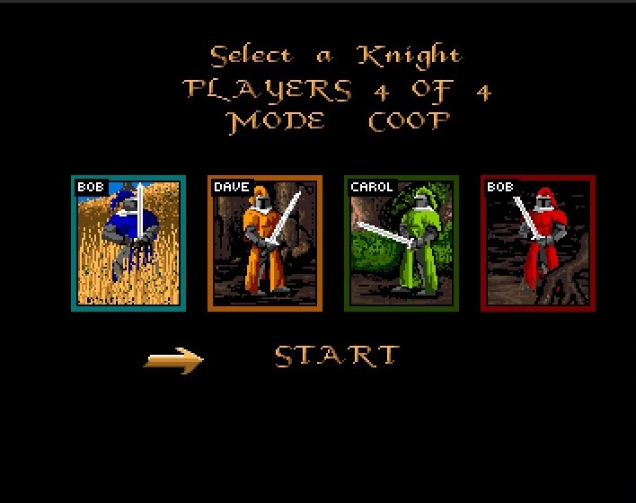

# moonstone-ace

**Moonstone: A Hard Days Knight** (Mindscape, 1991) rebuilt in C++ on [ACE](https://github.com/AmigaPorts/ACE), for the
**Amiga 1200** and **Windows PC**, with local co-op and online play for up to four knights.

This repository holds **none of Moonstone's data, art, music or code**. You need your own copy of the game: the three
original disks or disk images (`.adf`) made from them. The game reads them every time it starts.

## Windows PC

**Get it**

1. Download `moonstone-ace-…-windows.zip` from [Releases](https://github.com/Jarskih/moonstone-ace-public/releases) and unzip it.
2. Copy your three disk images (`.adf`) into its `disks` folder. The file names do not matter.
3. Start `moonstone.exe`. If Windows asks for a runtime, install the Microsoft Visual C++ Redistributable (x86).

**Play**

- Cursor keys and Right Ctrl or Space; a second player in co-op uses W A S D and Alt; gamepads work too.
- F11 fullscreen, F12 CRT effect, F10 shows or hides the ping line in online games.
- **Online:** Multiplayer, then **Find** to join a public game, or **Host game** to start one (no router setup needed;
  allow Moonstone through the Windows firewall when asked). On the same home network, **Join game** with the host's
  address, for example `192.168.1.20`. Choose your knight in the lobby; the host starts the game.

## Amiga 1200

**Get it**

1. Download `moonstone-ace-…-amiga.zip` from [Releases](https://github.com/Jarskih/moonstone-ace-public/releases), unzip it and
   copy the `Moonstone` drawer to your hard disk. (WinUAE: the zip includes a ready configuration.)
2. Put your three disk images (`.adf`) into `Moonstone/disks`.
3. Start `moonstone` from a Shell or its icon.

**Play**

- Joystick or keyboard; co-op knights can use a second joystick or the keyboard.
- **Online:** use `moonstone-ace-…-amiga-netplay.zip` instead (needs fast RAM and a TCP/IP stack: Roadshow, AmiTCP,
  Genesis or Miami). Then Multiplayer, **Find** or **Host game**, or **Join game** with the host's address on a home network.

Everyone in an online game needs the same game version. Windows and Amiga cannot play together yet.

## Mods

Rule tweaks need no rebuild: put an `.ini` file into the `mods` folder next to the game. `mods/defaults/rules.ini` lists
every setting with its default value. See [docs/MODDING.md](docs/MODDING.md).

## Building from source

`py tools/setup.py "path/to/disks-folder"` checks your disks and the toolchain, extracts the disks and builds the Amiga game.
The toolchain, configure lines for the Amiga and PC builds and all build variants are in [BUILD.md](BUILD.md); project
status is in [ROADMAP.md](ROADMAP.md), and [docs/PUBLISHING.md](docs/PUBLISHING.md) explains what is and isn't in this repository.
